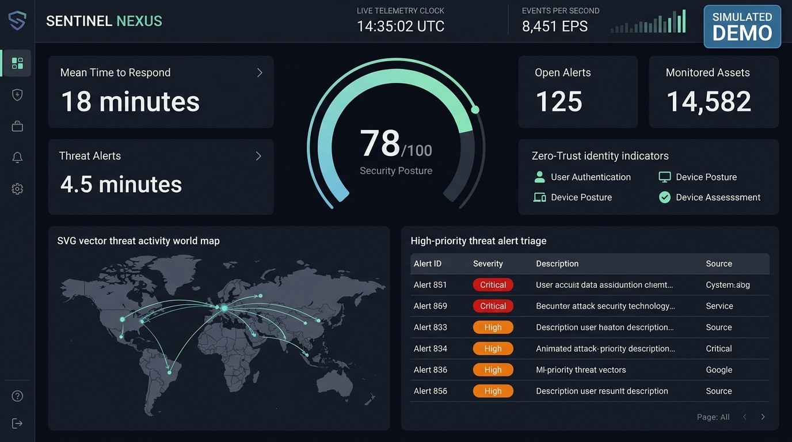

# 🛡️ CYBER SPACE — Autonomous SOC & Cyber Defense Center

[](https://tech-warrior11.github.io/Cyber-Space/)
[](https://github.com/tech-warrior11/Cyber-Space/actions)
[](LICENSE)
[](#purpose-and-safety-disclosures)

> **CYBER SPACE** is a futuristic, portfolio-grade Security Operations Center (SOC) dashboard simulation designed for interactive exploration. Visitors can experience modern security telemetry visualization, incident triage workflows, automated containment playbooks, and Zero-Trust architecture controls directly in the browser.

---

## 📸 Interface Preview



---

## 🚀 Live Demo Link

Explore the live application directly from GitHub Pages:  
👉 **[https://tech-warrior11.github.io/Cyber-Space/](https://tech-warrior11.github.io/Cyber-Space/)**

*(If deploying for the first time, see the [One-Time GitHub Pages Setup](#one-time-github-pages-setup) below).*

---

## 🎯 Purpose and Safety Disclosures

**CYBER SPACE is an educational and portfolio demonstration project.** It is engineered to simulate realistic enterprise SecOps workflows safely without posing any operational, privacy, or security risks:

- **100% Synthetic Telemetry:** All alerts, assets, CVE findings, usernames, and organization names are fictional.
- **Reserved Demo IP Blocks:** All IP addresses strictly utilize IETF **RFC 5737** test ranges (`192.0.2.0/24`, `198.51.100.0/24`, `203.0.113.0/24`) and RFC 3849 IPv6 blocks reserved exclusively for documentation and demonstration.
- **Zero Network Requests:** This application executes entirely client-side in the visitor's browser. It makes no external network calls to third-party APIs, LLMs, remote databases, telemetry collectors, or cloud infrastructure.
- **No Offensive Capabilities:** Does not scan hosts, probe URLs, exploit vulnerabilities, generate payloads, sniff traffic, or collect credentials.
- **Harmless Local State:** Containment actions (e.g., "Isolate Host", "Revoke Session", "Virtual Patch") update browser memory only and emit simulated feedback toasts and audit log entries.
- **No Real Security Claims:** This application does not protect real-world systems and does not represent an accredited certification or compliance assessment.

---

## ✨ Key Interactive Areas

The dashboard comprises 9 cohesive, operational areas:

1. **Executive Command Overview:** Dynamic radial Security Posture Gauge (0–100 score reacting to active incidents and policy adjustments), key metrics (Simulated MTTR, Monitored Assets, Open Alerts), and a live real-time simulated telemetry stream ticker.
2. **Interactive Global Threat Telemetry Map:** A self-contained, responsive vector SVG world map with animated attack vectors (e.g. STS AssumeRole Abuse, C2 Beaconing, Port Scans), pulsing infrastructure nodes, and clickable telemetry inspection cards.
3. **Threat Intelligence & Alert Queue:** Searchable and filterable fictional alert feed with severity chips (Critical, High, Medium, Low), confidence scores, and timestamps. Selecting an alert opens a detailed **Forensic Inspection Drawer** featuring MITRE ATT&CK mapping (`T1078.004`, `T1071.001`), synthetic IOCs, and response triggers.
4. **Asset Attack Surface Inventory:** Enterprise asset inventory of cloud compute instances, Kubernetes clusters, database pools, and workstation endpoints. Supports environment filters (Production, Staging, Corporate) and working **Simulate Host Isolation** / **Restore** toggles.
5. **Exposure & Vulnerability Management (CVEs):** Mock CVE findings with CVSS 3.1 scores, affected demo assets, and remediation guidance. Features an interactive **Simulate Virtual Patch** button that deploys simulated WAF/eBPF mitigations, improving posture and generating audit trails.
6. **Identity & Zero-Trust Posture:** Demonstrates continuous verification metrics: MFA adoption rate, privileged cloud accounts (with JIT access), service principals, and anomalous sessions. Includes an **Interactive Conditional Access Policy Engine** where users can toggle rules and watch the posture score recalculate in real-time.
7. **Incident Response Command & Playbooks:** Real-time multi-stage incident orchestration (`INC-2026-042`). Features an interactive 5-step containment playbook (Host Isolation, STS Invalidation, Perimeter ACL Block, Secret Rotation, Post-Mortem Resolution) with lead responder assignment.
8. **Compliance & Continuous Governance:** Compact compliance control coverage matrix comparing telemetry against **NIST CSF 2.0**, **SOC 2 Type II**, and **ISO 27001:2022** with plain-language requirement summaries and synthetic audit evidence.
9. **Activity & Audit Log with Browser Export:** Filterable chronological ledger of all operator actions, detections, and policy modifications. Includes **Export JSON** and **Export CSV** buttons that generate downloadable files client-side.

---

## 🎮 Guided Scenarios & Interactive Tour

- **In-App "Take the Tour" Stepper:** A 5-step onboarding walkthrough that explains key console components and can be launched or dismissed at any time from the top navigation bar.
- **Guided Attack Scenarios:** Switch between 3 realistic incident profiles via the header dropdown:
  - **Scenario 1:** *Cloud IAM Anomaly & Privilege Escalation* (AWS Production // FinTech)
  - **Scenario 2:** *Public Bucket Exposure & Secret Leak* (Data Analytics // S3)
  - **Scenario 3:** *Spear-Phishing & Lateral Host Probe* (Corporate Fleet // macOS EDR)
- **Audio Synthesizer Toggle:** Optional client-side Web Audio oscillator cues for button clicks and alert detections (default muted).
- **Reset Demo Data:** Instantly restore all telemetry, assets, and incidents back to a clean baseline.

---

## 🛠️ Technology Stack

- **Framework:** React 19 + TypeScript
- **Bundler:** Vite 6
- **Styling:** Custom CSS design system with CSS custom properties, glassmorphism, responsive flex/grid layouts, accessibility focus states, and reduced-motion support.
- **Icons:** Lightweight, maintained Lucide React icons
- **Zero Third-Party Scripts:** No external fonts, no CDN trackers, no remote analytics.

---

## 💻 Local Development Instructions

### Prerequisites
- Node.js (v18.0.0 or higher, v22+ recommended)
- npm (v9.0.0 or higher)

### Setup & Run
```bash
# Clone the repository
git clone https://github.com/tech-warrior11/Cyber-Space.git
cd Cyber-Space

# Install dependencies
npm install

# Start local development server
npm run dev
```

Visit `http://localhost:5173/` in your browser.

### Build Production Bundle
```bash
npm run build
```
The compiled static assets will be output to the `./dist/` directory.

### Preview Production Build
```bash
npm run preview
```

---

## ⚙️ One-Time GitHub Pages Setup

To activate automatic deployments through the included GitHub Actions workflow:

1. In your GitHub repository, open **Settings**.
2. In the left sidebar, click **Pages** (under the "Code and automation" section).
3. Under **Build and deployment** > **Source**, change the dropdown from *Deploy from a branch* to **GitHub Actions**.
4. Push a commit to `main` (or trigger the workflow manually under the **Actions** tab).

The included workflow (`.github/workflows/deploy.yml`) will build the project and deploy it to:
**`https://tech-warrior11.github.io/Cyber-Space/`**

---

## 📄 License

This project is licensed under the [MIT License](LICENSE).
Built for educational and portfolio presentation purposes.
